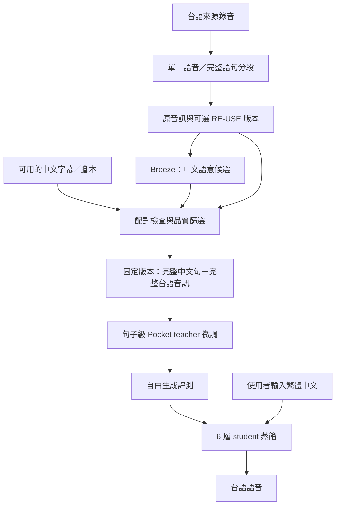

# 直接以繁體中文生成台語：Pocket TTS 研究修正

研究日期：2026-10-25。產品需求是一般繁體中文／華語語意輸入，輸出台灣台語，資料處理盡量不需要使用者聽打。本次依使用者要求採 pstack Investigation／how，派出兩位 Astra 與一位 Sol 分別研究文獻、程式和資料，再以 Astra 整合。

## 結論與前提修正

**直接訓練「華語文字 → 台語語音」不必具備台語正字或台羅逐字稿。** 仍需要語意相符的「中文文字＋台語錄音」配對；可以使用來源字幕、腳本或 ASR 產生的弱標註。台語發音的聲學監督存在錄音中，不一定要額外寫成台羅。

前版計畫把「華語先轉台語文字，再合成」和現有 loader 的同語言切句需求，誤當成產品的必要條件。應修正為：

- 直接句子級中文條件生成台語，作為下一個主要可行性實驗。
- 台語文字中間表示為可選對照，適合需要讀音控制或獨立檢查翻譯時研究。
- 原生台語 ASR／台羅 forced aligner 不再是直接路線的資料入庫先決條件。
- 已有台語逐字稿可保留，但不能不經轉換就混作「一般華語語意」輸入。每一筆訓練文字要符合選定的中文輸入契約。

這個判斷有文獻先例和程式依據；尚未證明 Pocket TTS 在本專案的語料量、噪音與運算預算下能達到可用品質。

## 研究證據

| 問題 | 已確認 | 尚不能推出 |
| --- | --- | --- |
| 是否必須台語文字才能學會生成台語 | 有研究直接訓練華語文字到台語聲學單元 | 少量配對就足以學好 |
| Pocket 核心是否要求字詞對齊 | 條件序列與 loss 不要求；限制來自目前 loader | 現有 training CLI 無須修改即可使用 |
| Breeze 華語輸出是否有用 | 可作直接任務的句子級弱標註 | 每筆都是完整、正確的華語語意 |
| 不讓使用者聽打是否可研發 | 可自動產生配對、篩選、試訓練與比較 | 所有聲調與自然度都已驗證 |

### 明確的台語先例

Meta 的 ACL 2023 論文 *Speech-to-Speech Translation for a Real-world Unwritten Language*，在 §3.2.3 明確描述以華語字元作輸入、台語正規化語音單元作目標的 T2UT；§4.1.4 說明使用台語戲劇與對應華語字幕，篩選後約 1,000 小時。這是與本需求接近的直接跨語言生成先例，並非單純跨語言音色複製。其聲學表示與 Pocket 的 Mimi latent 不同，不能直接套用效能或資料量結論。[論文](https://aclanthology.org/2023.findings-acl.307.pdf)

BreezyVoice 26 的官方展示接受一般中文並產生台語，支持產品介面的可行性。但 Breeze Taigi 論文沒有完整公布每筆訓練文字的 schema，不能據此斷言內部完全沒有文字轉換。已公開的舊 BreezyVoice 是台灣華語模型，也不能混同為可下載的台語版本。[MediaTek 官方展示](https://www.mediatek.com/zh-tw/tek-talk-blogs/mediatek-research-breeze-3)、[Breeze Taigi 論文](https://arxiv.org/html/2603.19259v1)、[舊版模型卡](https://huggingface.co/MediaTek-Research/BreezyVoice)

### Pocket TTS 的實際限制在哪裡

核心序列是「開頭標記、音色提示、完整文字、音訊起始標記、之前的目標音訊 frames」。每個生成位置都可看到完整輸入文字，loss 計算聲學 latent 與 EOS，沒有要求一個中文字對應一個台語音節的 loss。因此跨語言的詞彙及語序可以由模型學習，是否學得好則須實驗。[conditioner.py](../../training/modules/conditioner.py)、[model.py](../../training/modules/model.py)

目前 `DataLoader._choose_cut` 依 words 時間戳，把同一句前段取為提示，並由剩下的 words 重建後段文字。這種取樣假設不適用於華語語意和台語錄音任意一刀切，因為兩者不保證字詞一一對應。[loader.py](../../training/dataloader/loader.py)

**因此要改 loader，而不是強迫資料補出台羅。** 新增明確的 sentence 模式，保留既有 aligned 模式給原本任務使用。這是待實作設計，並非目前已存在的參數。

## 修正後的資料與模型流程



先切出語意相對完整的音訊單位，再對該單位產生中文標籤。不要先轉寫整段節目，之後隨意截短音訊卻保留整段文字。VAD 找停頓不保證找到句子；分段歧義、字幕涵蓋不同區間或內容明顯不一致時隔離，保留所有時間軸映射。

Breeze-ASR-26 的官方輸出是華語漢字表示，正好可作本直接路線的候選標籤。它仍可能漏句、錯認專名、改變否定或數量，因此記為 `asr_pseudo`，不標成 verified。缺少台羅不再是拒收理由。[Breeze 模型卡](https://huggingface.co/MediaTek-Research/Breeze-ASR-26)

下面只表示新的主資料 schema，並非已產生的真實樣本或目前 loader 可直接讀取的格式：

```json
{
  "schema_version": "zh-taigi-semantic-pair/v1",
  "utterance_id": "source-id_segment-id",
  "input_text_zh": "你吃飽了嗎？",
  "input_language": "zh-TW",
  "target_audio": "audio/segment.flac",
  "target_language": "nan-tw",
  "label_type": "asr_pseudo",
  "label_model": "MediaTek-Research/Breeze-ASR-26",
  "speaker_cluster_id": "source-local-speaker-cluster",
  "prompt_utterance_id": "different-utterance-same-speaker",
  "split": "train"
}
```

實際版本另存 revision、檔案 hash、來源區間、字幕、音訊處理、文字正規化與篩選紀錄。`prompt_utterance_id` 是可選項；不需要 `transcript_tailo`、台語正字或跨語言 words 對齊。訓練 adapter 將 `input_text_zh` 轉成目前文字條件使用的 `transcript`，欄位名不代表它是台語逐字稿。

繁體正規化只統一字形與輸入規則，不用 LLM 默默改寫事實；尤其數字、人名、地名、否定和時間要保留。台語同一意思可能有多個自然說法，模型學的是條件生成分布，不能保證中文能指定每個音節或口音。

## 最小正確實作範圍

| 部分 | 必要變更 | 驗證重點 |
| --- | --- | --- |
| Entry/schema/parser | 加 sentence 模式、utterance ID、可選獨立 prompt 引用 | 欄位不被現有 parser 丟棄，版本固定 |
| Raw loader | 整句文字配整段 target；繞過 `_choose_cut` | 不從 words 重建後半句、不截音訊留全文 |
| Voice prompt | 同語者另一句，或明確零提示模式 | 與 target 無重疊／近重複；prompt 和 target 同 split |
| Latent loader | 目標從 frame 0 開始；prompt 另讀 | 不使用現有零切點的 target-as-prompt fallback |
| Cache | key 納入新 schema、音訊區間與處理版本 | 清單重排不配錯 latent；train/valid 路徑均一致 |
| 中文 tokenizer | 在 train 中文文字上建立／檢查覆蓋率 | teacher/student/inference 使用同 tokenizer 與設定 |
| 訓練 | 24 層 teacher 先學直接任務，再蒸餾 | 英文初始化不是現成華台翻譯器，不能只訓 embedding |
| 推論 | 保留中文語意範圍，處理全形標點與長句 | 不沿用會改壞中文的英文正規化／切句 |
| 評測 | 固定中文輸入、獨立語者提示，自由生成 | 不能只看 teacher-forced loss 或英文 WER |

優先使用獨立同語者提示，接近既有 voice-conditioned 推論。無提示可作小型單語者對照，但不是把 `max_voice_prompt_sec` 設成 0；目前該值不代表無提示。真正零提示需要修改 collation 和 encode 流程，避免強制至少一個 prompt frame，並確保 teacher/student 條件一致。[types.py](../../training/dataloader/types.py)、[encode.py](../../training/dataloader/encode.py)、[model.py](../../training/modules/model.py)

目前「給整句一個 word」會避開缺少 words 的例外，卻觸發沒有有效切點時的 fallback，把目標音訊的一部分當作 prompt。這可能讓模型靠目標內容而非文字完成任務，不能當成快速解法。[loader.py](../../training/dataloader/loader.py)

先用 raw 音訊打通 sentence 路徑，再整合 latent cache，避免一次混入兩類錯誤。正式訓練前驗證 raw／cached 路徑的文字、音訊區間、有效長度與提示一致。Mimi 原先可編碼整段音訊，無須先取得台語文字；codec 的台語保真仍是獨立實測事項。

## 無需使用者聽打的資料檢查

- 字幕／腳本存在時，與 Breeze 候選做語意、數字、專名和否定檢查；字幕可作翻譯配對，不要求逐字同形，但不能漏掉整段內容。
- 語種判斷依音訊，不從繁體漢字推斷台語。新聞中的華語訪談先隔離，避免同一中文輸入被訓練成華語輸出。
- 比較 raw／enhanced 可檢查增強穩定性，但同一 Breeze 兩次結果不構成獨立驗證。RE-USE 版是衍生候選，原版永久保留。
- 原生台語 ASR 可選作另一種檢查，不是每筆都必須具備的中間產物。可用的獨立驗證器需先驗證能力，不能假設多個模型投票就正確。
- 單一語者、無重疊、低配樂、音訊完整、來源及使用範圍明確者優先；難例自動隔離，不轉成人工任務。
- 來源影片、同錄音切片、重上傳版本、raw/enhanced 和重複文本依群組分割，prompt 配對在 split 固定後建立。

自動檢查降低錯配，沒有已量測的依據就不報通過樣本「95% 正確」。不要求每筆都同時具有字幕和第二套 ASR；標記證據等級，在實驗中比較不同等級的結果與保留率。

## 下一個實驗如何回答可不可行

| 階段 | 目的 | 交付與停止條件 |
| --- | --- | --- |
| D0：配對 pilot | 用約 30–60 分鐘候選來源驗證自動產線 | 固定中文語意配對、來源／品質報告；這個規模只驗證流程 |
| D1：sentence loader | 證明文字和完整 target 正確進入模型 | 無 words 也能取樣；target 不洩漏進 prompt；過長資料明確拒收 |
| D2：微型學習檢查 | 檢查訓練與生成是否有基本訊號 | loss 有限、生成可結束；同 prompt 換中文內容會改變內容。記憶訓練句不算泛化 |
| D3：分級擴量 teacher | 量測未見句子上是否保留中文語意且說台語 | 依有效時數擴量，記錄學習曲線；沒有改善則回查配對／模型能力，不直接無限訓練 |
| D4：蒸餾與 CPU | 已有合格 teacher 才壓縮 | 相同文字／提示條件，評測品質與 CPU 延遲；蒸餾不會補出 teacher 沒學會的翻譯 |

以上新增流程都尚未實作或執行；不把 30–60 分鐘當作學會通用華台轉換的充分資料。既有同語言台語逐字稿 baseline 可當聲學參考，但不是直接中文任務的可比對照；要比較需先建立相同中文輸入契約。可優先比較有來源字幕支持與 Breeze-only 的兩組直接配對，固定其他條件。

自由生成評測至少分成：中文語意保留、輸出是否為台語、數字／專名、漏讀／重複／EOS、聲音品質、音色一致性與 CPU 速度。Breeze 可用於相對診斷，不能同時作唯一標註者與唯一裁判。沒有獨立 reference 或已驗證評測器時，該部分只能報代理指標，不能宣稱通用語意／台語聲調已驗證。

前述 Breeze 論文也顯示自然度與台語發音比例可以有明顯差異，因此自動語意分數不能作為所有語音品質的替代品；這不構成要求使用者逐段聽打的理由。[Breeze Taigi 評測](https://arxiv.org/html/2603.19259v1)

## 研究方法與驗證範圍

使用 [pstack Investigation](https://github.com/backnotprop/pstack/blob/18b6c36e6e201b110acc62472de987416ac4e23b/skills/poteto-mode/playbooks/investigation.md) 與 [how](https://github.com/backnotprop/pstack/blob/18b6c36e6e201b110acc62472de987416ac4e23b/skills/how/SKILL.md)，版本 `18b6c36e6e201b110acc62472de987416ac4e23b`。依專案 AGENTS 指定偏好，採可用的 Astra／Sol 做 bounded read-only explorers，並由 Astra explainer 整合；主代理獨立核對核心程式、論文與來源。

- Astra：直接華語到台語生成的論文與官方模型證據。
- Astra：Pocket conditioner、loss、raw/latent loader、prompt 與蒸餾。
- Sol：Breeze 弱配對、YouTube 分段、低人工介入與自動評測限制。
- Astra：整合架構、配對資料與實驗建議，釐清前版過度限制。

`throughput checkpoint: n/a, read-only investigation`

本次只有研究與計畫文件修正；沒有修改訓練程式、下載 YouTube、啟動 GPU 或取得新的品質數字。本文件取代舊計畫中「原生台語文字和逐字對齊是所有路線必要前提」的說法。Git、不可變資料版本、Nebius 儲存、checkpoint 備份與低人工介入管理仍沿用[管理計畫](2026-10-25-taiwanese-pocket-tts-mlops-plan.md)。
