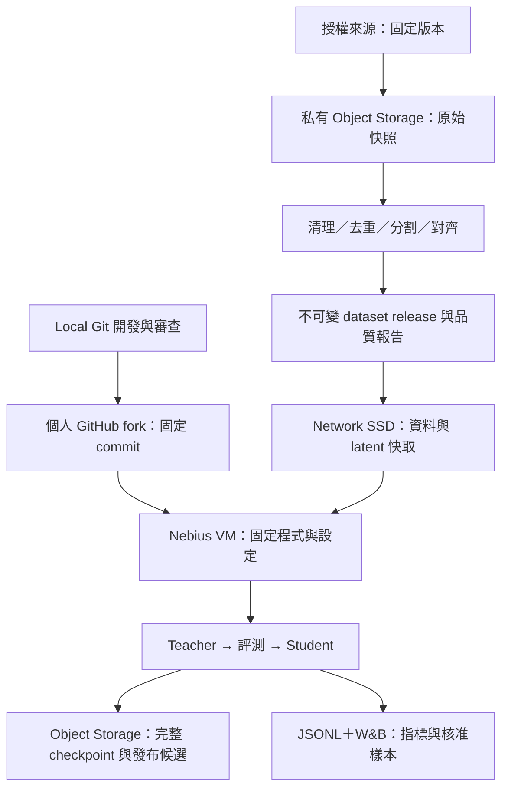

# 台語 Pocket TTS：資料、Git、Nebius 與實驗管理計畫
Created: 2026-10-25

執行更新：下文的「尚未」描述屬於規劃時點；後續已建立開發分支、private W&B
專案並啟動真實音訊訓練。最新操作見[試跑指南](../taigi-pilot.md)，
具體驗證與 US$50 預算限制見[執行計畫](../plans/2026-10-25-taigi-pipeline-execution.md)。

本文件延續[模型與語料研究](2026-10-25-taiwanese-pocket-tts-plan.md)，目標仍是使用者輸入一般繁體中文，系統產生自然台語。這是執行前的管理設計；尚未建立分支、推送、配置雲端資源、串接 W&B 或啟動訓練。

**目前執行偏好：使用者沒有時間逐段試聽或修訂。第 8 節的低人工介入流程為最新執行契約，取代下文舊版要求使用者人工抽聽、聽打或逐段核准的步驟。** 既有標註可供基準；新資料用自動檢查與隔離流程。人工聽測僅作日後可選的獨立品質驗證，不阻塞研發，也不假稱已完成。

**架構修正：主要可行性試驗改為「完整繁體中文語意句子 → 完整台語音訊」。** 台語正字／台羅不是必要欄位；Breeze 華語輸出可作弱配對。第 8 節已同步取消原生台語 ASR／逐字對齊的通用入庫門檻。實作與證據以[直接生成研究](2026-10-25-direct-zh-to-taigi-pocket-tts-research.md)為準；本文件其他 aligned loader 細節保留給原有兩階段對照方案。

## 建議架構

採用個人 GitHub fork 管程式與設定、Nebius 私有 Object Storage 管不可變資料版本與備份、獨立 Network SSD 管訓練工作集、W&B 管實驗比較。保留現有 `progress.jsonl`，讓追蹤服務中斷不影響訓練。若不使用外部追蹤服務，改以 TensorBoard 讀取本機日誌；雲端連線偏好尚未確認。



| 資產 | 主要位置 | 版本依據 |
| --- | --- | --- |
| 程式、清理規則、訓練 YAML、依賴 lock | GitHub fork | 完整 Git SHA |
| 可公開的來源描述、版本鎖、彙總品質報告 | GitHub fork | Git SHA 與 dataset ID |
| 原始音訊、逐字稿、完整 manifest、修訂紀錄 | 私有 Object Storage | 來源 revision、檔案 SHA-256、不可變前綴 |
| 訓練工作集、解壓音訊、latent cache | VM 的獨立 Network SSD | dataset／preprocessor／Mimi 等相依雜湊 |
| 可續訓 checkpoint、optimizer、設定、日誌 | SSD 寫入後備份到 Object Storage | run ID、attempt ID、step、完整 bundle manifest |
| 實驗指標、設定摘要、允許分享的生成音訊 | W&B；JSONL 同時保留 | run／attempt ID 與各資產版本 |
| 發布模型及中文轉台語 frontend | 經驗證的 release bundle，後續可發布 HF | release manifest 固定所有相依版本 |

## 1. 訓練資料怎麼管

### 依任務管理配對

直接路線的主資料是「華語語意句子＋對應台語錄音」，來源可為字幕、腳本或 Breeze 候選；原生台語文字可選。以下兩類仍可保留作聲學參考與兩階段對照，但不再是直接路線必須同時具備的資料。

1. **聲學 TTS 語料**：台語錄音與實際說出的台語逐字稿，另保留語者、來源、時間戳及文字表示。不能把華語錄音換上台語翻譯後拿來訓練台語聲音。
2. **中文轉台語資料**：華語句子與有來源的自然台語表達，用於 frontend 評測，日後才考慮翻譯模型微調。優先整理既有可信對照，涵蓋數字、否定、專有名詞、疑問與日常用詞；不要求使用者新做 200 組人工標註。缺少獨立 reference 的項目標為未驗證。評測集不參與 frontend 或 TTS 訓練。

英文和台灣華語音訊先保留為獨立來源；只有要研究英文能力保留或華台夾雜時才建立明確的混合實驗。三個 ADI repo 不是逐筆平行語料，不按列號配對。

### 原始資料永遠保留，修訂產生新版本

下列 bucket 名稱與路徑是設計示意，尚未建立：

```text
s3://<private-bucket>/taigi/
  raw/<source>/<revision>/             原始下載、授權副本、checksums
  annotations/<revision>/              人工修訂與 ASR 候選，保留來源
  datasets/<dataset-id>/
    manifest.jsonl                    私有逐筆 metadata
    splits/                           train、dev、test 與分組依據
    quality-report.json               通過／隔離原因、時數、覆蓋率
    recipe.json                       程式 SHA、規則及來源版本
    READY.json                        所有檔案完成且校驗後才發布
  derived/<dataset-id>/<recipe-hash>/
    audio/                            必要的重採樣與切片
    alignment/                        時間戳、可信度、文字位置映射
    train-latents/<mimi-hash>/         僅供 train
  tokenizers/<tokenizer-hash>/
  runs/<run-id>/<attempt-id>/
  releases/<release-id>/
```

`raw` 不覆寫；修正逐字稿、換對齊器、改切分規則都產生新版本。新版本可引用既有音訊物件，不必複製整套原始音訊。用小型連續 shards 批次傳輸可減少大量小檔開銷，但 shard 格式仍須經匯入器轉為現有 loader 可讀的本機路徑。

Object Storage 是長期保存來源，SSD 是當次工作集。先下載、驗證 hash、再以完成標記發布本機快取；不要把普通 `s3://` 路徑直接塞進目前的音訊 loader，也不預設 FUSE 掛載適合訓練。遠端 manifest 保存相對路徑或物件 ID，啟動時產生本機路徑版本，同時保存兩者的對應。

Nebius 提供獨立的 [Object Storage](https://docs.nebius.com/object-storage/index)。存放來源資料仍須符合各資料條款；申請型資料依核准範圍另設存取邊界。

### 每筆資料要能回答「從哪裡來、為何可用」

完整的私有 manifest 至少包含：

| 欄位群 | 內容 |
| --- | --- |
| 身分與來源 | 穩定 sample ID、source repo、revision、原始 clip ID、recording/group ID |
| 音訊 | object URI、SHA-256、秒數、採樣率、聲道、切片起訖、原檔關係 |
| 語者與語種 | 來源內的去識別化 speaker ID、locale、口音資訊與可信程度 |
| 文字 | 原始逐字稿、校正版本、漢字／台羅表示、normalizer 版本 |
| 品質 | 檢查結果、排除原因、人工覆核狀態、ASR 模型版本與候選結果 |
| 對齊 | aligner 版本、字詞時間戳、文字映射、有效 prompt/target 切點 |
| 使用條件 | 授權來源、條款版本、訓練／模型發布／樣本展示的確認狀態 |
| 分割 | train/dev/test、split recipe、音訊與文本重複群組 |

Speaker ID 用於防止資料洩漏與統計，不嘗試識別真實人物。這份逐筆清單可能含逐字稿與來源識別，預設放私有儲存；公開 Git 只放經檢查的來源描述、hash 與彙總統計。

### 先處理 ADI 的已知問題

已驗證的 ADI Hokkien revision 為 `ffcc36b9afe31ec50f7742c0c4c614f1a5b40151`，原始 `train.tsv` 有 31,482 筆：23,158 筆 locale 為 `nan-tw`，2,792 筆為 `zh-CN`，5,532 筆空白。部分台羅聲調字元已在檔案內變成 ASCII `?`。這些是 metadata 檢查結果，尚未下載全體音訊或測量可訓練時數。[檢查證據](2026-10-25-adi-hokkien-evidence.json)、[固定版本 TSV](https://huggingface.co/datasets/adi-gov-tw/Taiwan-Tongues-ASR-CE-dataset-hokkien/blob/ffcc36b9afe31ec50f7742c0c4c614f1a5b40151/train.tsv)

依序執行：

1. 保存來源快照及授權；擷取 Common Voice 原始 clip ID。
2. 先隔離明確華語資料。locale 空白或矛盾者需補證據，不按資料集名稱自動判成台語。
3. 依 clip ID 追溯上游原始逐字稿；無可靠來源者保留待覆核，不猜補損壞聲調。
4. 與直接下載的 Common Voice 資料跨來源去重，避免把彙整版算成額外時數。
5. Breeze-ASR-26 作異常篩查；原始標註與 ASR 猜測分欄保存，無法自動確認的資料隔離，不派發人工修訂工作。
6. 統計清理後時數、語者數、有效切點通過率，再決定 pilot 的規模。

資料卡的「開放」不能替代逐份授權記錄；ADI 的 LICENSE 為 TRAIL 0.1，資料使用與模型產物條件需要納入發布判定。未確定的來源維持獨立實驗 lineage，避免混入預定公開的候選。[ADI LICENSE](https://huggingface.co/datasets/adi-gov-tw/Taiwan-Tongues-ASR-CE-dataset-hokkien/blob/main/LICENSE)

### 發布 dataset release 前的門檻

- 音訊可解碼，時長與文字相符；靜音、截斷、削波與語種疑點有統計及隔離結果。
- 先保護官方 test，再跨來源查重。相同錄音的切片、不同麥克風版本與近重複音訊不能跨 split；相同評測文本也要排除訓練洩漏。
- 依語者／錄音群組分割，分開報告未見語者與已見語者的未見文本。單語者資料只能支持後者。
- Tokenizer 與其他需從資料學習的前處理只使用 train；dev 用於選模型，test 在選定候選後才作正式驗收。
- 每段有可靠對齊，而且符合現有 loader 的非重疊 prompt/target 切分要求。大於兩秒本身不代表能用；兩側都需足夠時長與內部邊界。
- 對齊後重建的 target text 保留正確台羅、聲調與分隔；長錄音先切片，避免 loader 截短音訊卻保留全部文字。
- 以既有標註基準和第 8 節自動關卡檢查；各來源、語者與特殊發音覆蓋度列入報告。新增人工抽聽為可選項，不是資料版本發布前的使用者待辦。
- 輸出總下載時數 → 語種確認時數 → 文字確認時數 → 對齊合格時數 → 實際可訓練時數，各步有排除理由。

合格版本例如 `taigi-tts-v0.1-<manifest-hash>`。每個版本保存 recipe、split hashes、來源權利紀錄與品質報告；訓練設定固定版本，不使用會變動的 `latest`。

### DVC 要不要現在加？

第一階段建議先以不可變 Object Storage 路徑、SHA-256 manifest 與 Git 中的小型 dataset lock 管理，避免同時維護多套版本來源。DVC 留作之後評估：當資料處理分支很多、多人經常重建相同資料，或手動相依管理已容易出錯時再導入。無論是否使用 DVC，逐字稿修訂歷史、授權、去重和 split 邏輯仍須由我們設計。

## 2. Local Git 與個人 repo

已確認本機在 `main`，HEAD 為 `44cb63eaa4144f32ff80863968515165a5554353`；目前 `origin` 指向 Kyutai upstream。個人公開 fork `MIBlue119/pocket-tts` 已存在，不需要另建重複 repo。

建議讓 `upstream` 指向 Kyutai、`origin` 指向個人 fork；先 fetch 並確認兩邊分支關係再調整。保留既有 fork 歷史，不 force-push。

| 分支 | 工作 |
| --- | --- |
| `main` | 個人專案已驗證的整合版本 |
| `feat/taigi-data` | 來源版本、匯入、品質檢查、split 與資料發布 |
| `feat/taigi-mlops` | run manifest、追蹤 adapter、備份／續訓與 Nebius runbook |
| `feat/taigi-training` | 台語 tokenizer、對齊整合、teacher/student 設定 |
| `feat/zh-to-taigi` | 中文輸入 frontend 與語意評測 |

功能分支開 PR 到個人 fork；merge 後 VM 依完整 SHA checkout。每次調整超參數不必建立分支，使用 versioned YAML 與 run ID。訓練期間不在同一 checkout 做 `git pull` 或改程式；每個 run 使用固定 checkout，程式變更另起實驗。

公開 Git 不含原始語音、完整逐字稿、checkpoint、API keys 或私有明細。現有 `.gitignore` 已排除部分音訊／權重，但尚不能涵蓋所有 tracker 檔案；實作時補齊 `wandb/`、event files、下載快取等，並檢查 staged diff。資料描述放 `configs/datasets/` 等目錄，避免被既有 `/data*/` ignore 規則意外排除。

## 3. Nebius 運算與磁碟

初期配置建議：100 GiB 系統碟、300–500 GiB 獨立且具冗餘的 Network SSD 工作碟、一個私有 Object Storage bucket。先測量解壓資料、latent、兩組完整 checkpoint 與上傳 staging 所需空間，再決定實際容量。資料準備可在 local 或 CPU VM 做；GPU 只在 ASR、codec 或訓練階段啟動。

選 `network_ssd` 作初期持久工作碟，若實測 I/O 成為瓶頸再比較 `network_ssd_io_m3`。明確管理工作碟的生命週期，刪除／重建 VM 前保留磁碟並驗證備份。單一 Network SSD 不能同時掛給多台運作中的 VM；目前單卡不需要 Shared Filesystem。Local SSD 停機或刪除會清空，只作可重建快取。[Nebius 儲存類型](https://docs.nebius.com/compute/storage/types)

正式 teacher pilot 先用單張 H100 on-demand；先完成小資料 smoke 與續訓演練，再考慮 Spot。GPU、區域、quota 與鏡像存取尚未驗證。現有 Dockerfile 服務推論用途，不視為已備妥 GPU 訓練容器；初期採官方 GPU VM image、固定 Python 與 `uv.lock`，記錄 PyTorch／CUDA／driver，後續再固定訓練容器 digest。

2026-10-25 公開表價示例：H100 $4.50/GPU-hour；Network SSD erasure-coded $0.071/GiB-month；Standard Object Storage $0.0147/GiB-month。100 GiB boot＋500 GiB 工作碟＋500 GiB 實際物件量約 **$49.95/月儲存費**，另加 GPU、請求、流量與稅費；這是容量範例，不是已建立資源或完整帳單。[Nebius 價目](https://nebius.com/prices)

完成工作後透過 Nebius console/API 停 VM；Linux `shutdown` 可能觸發平台重新啟動。停 VM 後磁碟與物件仍會計費。[停止行為](https://docs.nebius.com/compute/virtual-machines/stopped-with-linux-commands)

## 4. W&B 或 TensorBoard

| 面向 | TensorBoard | W&B |
| --- | --- | --- |
| Loss、學習率、音訊 | 支援 | 支援 |
| 使用方式 | 保存 event files，在 local 或 SSH tunnel 開啟 | 跨機器比較實驗、設定、表格與生成樣本 |
| 資料／模型追溯 | 另外維護 manifest | Artifacts 可連結來源與產物，仍需自己的內容校驗 |
| 維護負擔 | 小，需自行整理實驗及共享 | 雲端服務較方便，須確認帳號方案、權限與上傳內容 |
| 本專案定位 | 不使用外部服務時的首選 | 允許雲端追蹤時的首選 |

依據：[PyTorch TensorBoard](https://docs.pytorch.org/docs/2.14/tensorboard.html)、[W&B 媒體記錄](https://docs.coreweave.com/products/wandb/track/log/media)。不要求兩者都接，也不在第一階段導入 Kubernetes、Kubeflow 或完整排程平台。

現有 `ProgressLog` 已產生訓練／驗證／checkpoint 事件，尚未原生整合兩種 tracker。先加薄的 adapter，從完整 JSONL 記錄轉送標量；保留讀取位置與去重 ID，略過尚未寫完的尾行。生成樣本與系統指標另外明確接入。tracker 斷線或失敗不得使訓練中止。

W&B 只記錄核准的設定摘要、指標、asset hashes／references 與可展示的生成音訊。原始錄音、完整逐字稿與大 checkpoint 保留 Nebius；外部 reference artifacts 只保存物件 metadata，不是備份，也不能直接在 UI 播放引用音訊。Nebius 的 S3 endpoint 需部署時設定並驗證，不能假設 AWS 預設 endpoint 適用。[W&B external references](https://docs.coreweave.com/products/wandb/artifacts/track-external-files)

尚未確認 W&B 雲端偏好，第一個整合測試使用 offline 或 disabled 模式。W&B 支援 `WANDB_MODE=offline`，並可控制 console 與 code 上傳；設定內容本身也須檢查，避免日誌把私有逐字稿或 token 帶出去。[W&B 環境設定](https://docs.coreweave.com/products/wandb/track/environment-variables)

每次固定評測記錄 loss、吞吐、峰值 VRAM、GPU 使用率、資料等待、累計 GPU 時數／估算費用，以及漏讀／重複／EOS 異常與可量測的 ASR 相對指標。沒有母語者評測時，可懂度與聲調人工評分留空。中文 frontend 對既有 reference 比較語意、數字與否定，沒有 reference 的項目另列。音訊對照固定文本、voice prompt、seed 與解碼參數；現有取自訓練 batch 的預設樣本不足以做跨實驗公平比較。

## 5. 每次 run 的契約與可靠續訓

啟動器先檢查資料 READY 與 hash、權重可讀、磁碟容量、乾淨的固定 Git SHA，以及 train/valid 的格式。現有程式會拒絕 latent-backed `valid_jsonl`；驗證仍需原始音訊的 aligned manifest。

`run_manifest.json` 至少記錄：run ID、attempt ID、parent run、完整 Git SHA、原始與最終解析設定、dataset/split hashes、tokenizer hash、Mimi hash、base/teacher 權重 revision/hash、文字與對齊版本、seed、Python/依賴/GPU/driver、開始時間、儲存路徑、追蹤 ID、最大 steps／wall time／預算上限。所有秘密使用環境或受限憑證檔，不寫進 manifest。

Latent cache 的 key 不只包含 Mimi：還需 dataset manifest、切片／採樣率／正規化 recipe 與實際產生 latent 的程式版本。目前檔名使用 codec hash、manifest basename 與 row index，且可依檔案存在直接略過計算；原地重排清單可能讓新文字配到舊音訊 latent。先用不可變 dataset 目錄隔離，實作時再補完整內容 key；修改相依項後不可默默重用舊快取。[precompute_latents.py](../../training/scripts/precompute_latents.py)

程式目前會先寫入 `args.yaml`，再自動選擇 run directory 中最新數字 checkpoint，沒有完整設定身分比對。啟動器需在呼叫訓練程式前比對既有 run manifest，拒絕資料、tokenizer、Mimi、teacher 或其他不相容設定的變更；不同實驗不能共用 run directory。Checkpoint 與 optimizer 分別原子寫入，但不是同一個原子交易；缺 optimizer 時現有 loader 會警告後以新 optimizer 繼續。管理層必須補以下流程：

1. checkpoint 事件發生後，將該 step 的 model／EMA `.pt`、同 step optimizer、設定與相依 hashes 固定成 bundle。上傳前 staging 需完成，防止下一次 checkpoint 清理舊 optimizer。
2. 計算各檔案 SHA-256，上傳不可變 run/attempt/step 路徑，校驗後最後寫 `READY.json`。
3. 只從有 READY 且檔案完整的 bundle 恢復。最新不完整就退回上一組完整版本，不把 fresh optimizer 當續訓成功。
4. 至少保留最近兩組完整可續訓 bundle，以及依固定 dev 評測規則選定的候選；清理必須排除仍在上傳或被 release 引用的資產。
5. 在另一個空工作目錄／新 VM 實際恢復一次，核對 step、權重、EMA 與 optimizer 狀態，再試跑數步。

目前程式不保存完整 RNG／dataloader 狀態，恢復不保證與未中斷訓練逐位元一致。若需要這種等級的重現性，另列工程工作，不能只因 seed 相同就宣稱已達成。[checkpointing.py](../../training/checkpointing.py)、[train.py](../../training/train.py)

每次重新執行使用新的 attempt ID，與原 run 分組；回到較早 step 時保留前次嘗試，不把圖上的 step 回退偷偷覆蓋。W&B 的 run resume 只恢復追蹤身分，模型恢復仍由 checkpoint bundle 負責。

用可脫離 SSH session 的服務啟動訓練，記錄 heartbeat、exit code 與 completed/failed/interrupted 狀態。最大步數外另設 wall-time watchdog；正常停止先給訓練程式儲存時間，再備份，最後停止雲端 VM。遇到程序卡死需外部逾時處理，不只依賴訓練迴圈自己檢查。現有 SIGTERM handler 可協助正常收尾，但無法保證硬體斷電前保存。

## 6. 實施順序與完成證據

| 階段 | 交付 | 完成條件 |
| --- | --- | --- |
| A：Git 與來源清單 | 個人 fork remote／分支策略、來源 lock、排除規則 | PR 明確指向個人 repo；沒有原始資料或秘密 |
| B：資料 v0.1 | 匯入、清理、去重、split、自動檢查與隔離報告 | 從固定來源重建相同 manifest；可訓練時數有實測 |
| C：儲存與 run tracking | 私有 bucket、持久碟、run manifest、JSONL adapter | 同一資料版本在新工作目錄還原；offline 指標可查 |
| D：小型訓練與恢復 | 少量資料 smoke、checkpoint bundle、固定評測音訊 | 中斷後還原 optimizer 並繼續；備份缺件會明確失敗 |
| E：Teacher pilot | 幾個固定設定的實驗與對照 | 固定 dev 自動評測，保留 baseline；不以 loss 單獨選模型 |
| F：Student 與中文入口 | 選定 teacher、蒸餾、frontend 整合 | 固定語意案例、生成有效性、CPU 延遲有量測；未驗證發音列明 |
| G：發布候選 | 版本化 bundle、model card、來源與評測 | 空環境可載入與生成；標明自動評測範圍，公開發布另行決定 |

CI 驗證資料 schema、split 洩漏、設定與小型 fixture；保留 repo 原有必要 checks。現有 CI 有真實模型下載與生成，不將它描述為全離線測試。付費 GPU smoke 採明確觸發；不讓每次 push 自動啟動完整訓練。

選中的 checkpoint 固定後再輸出 EMA safetensors。`model.safetensors` 目前每次儲存會覆寫，因此最新檔案不等於最佳模型。Release 需包含 tokenizer、推論 YAML、台語文字規則、中文 frontend 版本、依賴與聲音提示來源；僅有權重不足以重現中文輸入產品。

## 7. Hugging Face 相容格式與 YouTube 衍生資料

本節描述 YouTube 來源與格式；執行方式依第 8 節改為自動標註、篩選及隔離，不再要求使用者人工校正。來源清單見[既有華台混語 ASR 評估構想](2026-10-25-taiwanese-asr-youtube-sources.md)。該文件的原始目標是 ASR 評估，不能把其中的測試錄音全部轉進 TTS 訓練；先保留獨立評測部分，再建立訓練候選池。本次未下載或試聽清單中的影片。

### 格式：統一資料定義，提供不同匯出

Hugging Face 沒有要求所有語音資料集使用相同欄位。建議以私有 canonical JSONL manifest＋外部音訊物件作主版本；必要時產生 Parquet 查詢副本。從同一個 release 匯出 HF 與 Pocket TTS，避免兩套人工維護的真相。

| 層級 | 建議形態 | 用途 |
| --- | --- | --- |
| 來源層 | 原始下載、metadata、字幕、來源授權證據 | 可追溯的原件 |
| 統一資料層 | 帶 schema version 的 JSONL＋音訊 URI/hash | 全部處理步驟與人工修訂共用 |
| Hugging Face 匯出 | 初期 AudioFolder＋`metadata.jsonl`；需要時再做 Parquet | `datasets` 載入、分析與有權限的分享 |
| Pocket TTS 匯出 | 本機音訊＋aligned JSONL | 目前訓練 loader 直接使用 |
| 可選校正介面 | SRT/VTT 加穩定 segment ID 對照檔 | 日後若有校正者可匯回修訂；不阻塞自動流程 |

HF AudioFolder 支援 JSONL metadata，使用 `file_name` 相對路徑關聯音訊；也能用 `raw_file_name`／`enhanced_file_name` 表達一筆的多個音訊版本。單純在 Parquet 放私有 `s3://` 字串不代表 Hub viewer 能存取音訊；公開匯出需另處理可存取檔案與權利。[HF 音訊資料建立文件](https://huggingface.co/docs/datasets/audio_dataset)

Pocket TTS adapter 只輸出 `path`、`duration`、`transcript`、`start`、`words`，及需要時的 `latents_file`。`path` 在 VM 解決為實際可讀路徑，`start` 是 utterance 在該檔案內的秒數，`words` 的時間相對於 utterance。已實體切片的檔案通常 `start=0`。SRT 的整句字幕時間戳不足以取代目前 loader 要求的內部字詞切點。[Entry 定義](../../training/dataloader/types.py)、[loader](../../training/dataloader/loader.py)

現有 `align_data.py` 預設英文 wav2vec2，並用空白切 word。把無空白中文直接送進去可能整句只剩一個 word；需要相容台語的聲學對齊器與明確的文字切分／映射，不能直接沿用預設。沒有有效切點的資料須擋下，避免 loader 走入 prompt 與 target 重疊的 fallback；超長句也必須先切段。[align_data.py](../../training/scripts/align_data.py)

統一資料層在前述 manifest 欄位外增添：

- `source_video_id`、`channel_id`、下載時間、選取音軌格式、原始來源 hash。
- `source_start_sec`／`source_end_sec`、`segment_id`、來源錄音／近重複群組，以及 split。
- `audio_raw`、`audio_enhanced`、選定訓練音訊版本與各自 hash；所有增強參數和模型 revision。
- `asr_candidate_zh`、`transcript_taigi_verified`、`transcript_tailo_verified`、`translation_zh_verified`。未取得的欄位留空，不把候選華語文本改名成台語逐字稿。
- 語種及必要的片段級 language spans、語者邊界、重疊語音標記、人工修改來源和狀態。
- `alignment_audio_hash`、對齊文字版本、時間軸映射與品質狀態；聲音版本改變即重新驗證對齊。
- 分開的 `asr_eval_eligible`、`tts_train_eligible` 與來源使用範圍。人工作業有版本，不原地抹除舊標註。

### 工具角色與限制

**yt-dlp** 負責取得來源與 metadata。保存 `--write-info-json`，用 `--download-archive` 防止重複下載；另外以實際檔案 hash／完成狀態驗證產物，archive 不代表下游處理成功。記錄 yt-dlp、FFmpeg 版本；下載字幕是候選參考，畫面內嵌字幕不是可直接下載的字幕軌。[yt-dlp 官方文件](https://github.com/yt-dlp/yt-dlp)

**RE-USE** 負責語音增強，不產生逐字稿。官方提供長音訊分塊處理，且說明重疊語音會偏向保留主要語者。因而原始與增強版必須並存；不能用它取代語者分段，也不假設它保留所有被訪問者的話。模型卡的跨語言說明尚不能證明台語聲調、鼻化與韻尾保真。[RE-USE 模型卡](https://huggingface.co/nvidia/NVIDIA-NemotronLabs-RE-USE)

**Breeze-ASR-26** 負責產生華語漢字候選轉寫；官方明確說明不是台語正字輸出。這可以協助檢索及語意參考，但不能自動填入本計畫的台羅 TTS target。台語漢字、台羅、華語意譯分欄，保留自動或來源標註的身分，不預設已人工核對。[Breeze-ASR-26 模型卡](https://huggingface.co/MediaTek-Research/Breeze-ASR-26)

不要預設把 DeepFilterNet、Resemble-Enhance 與 RE-USE 串在一起。先比較不增強與單一 RE-USE，確認改善才增加步驟。保留下載音訊的原始編碼／採樣率；ASR 與 TTS 各產生符合其設定的衍生版本。目前選定 Pocket 配置為 24 kHz，ASR 採樣率依 processor 設定；不要把 ASR 低採樣率版本當成唯一母檔。升頻也不能恢復原始遺失的資訊。

### 建議的實際產線

1. 建立影片來源清單與可使用範圍，固定來源／內容群組及保留測試集。YouTube 公開影片不自動等於開放訓練語料；保存個別授權或許可依據，RE-USE 的模型授權也不授予影片權利。[YouTube 授權類型](https://support.google.com/youtube/answer/2797468?hl=zh-Hant)
2. 保存原始音軌、metadata、可用字幕與 checksums。新聞重播、不同頻道重上傳也做內容查重，不能只靠 video ID。
3. 在原始時間軸做 VAD、語者邊界、重疊語音與語種候選標記。VAD 只找說話區間，不能代替語者分段或語種判斷；工具仍需小樣本選型。
4. 選完整短語句並保留邊界緩衝，產生 raw/enhanced 兩份候選；長音訊使用有時間軸對應的分塊方法，不拼接略過的靜音卻沿用舊時間戳。
5. 原始與增強版分別跑 Breeze，保存輸出、設定及模型版本。兩者差異大、混語或低品質片段隔離；相同結果仍不代表正確。
6. 依第 8 節取得及檢查原生台語候選；字幕／Breeze 輸出只作輔助。保留語碼切換、漏字、重複等判斷，不把華語字幕逐字轉台語讀音後視作真實發音。
7. 對最終選用的音訊與核准台語 target 產生可靠字詞／音節對齊，檢查聲調表示、音訊版本和有效切點。Breeze 的句級時間戳不是已驗證的台語 forced alignment。
8. TTS 候選以單一語者、無重疊、文字精確對應、無明顯配樂殘留或增強假音為主。混語資料另列，不放進台語單語 baseline。
9. 發布不可變 release，同時匯出 HF 和 Pocket view。兩個 view 的 sample ID、split、文字版本和實際解碼音訊需核對一致；latent cache 綁定選定的音訊 hash。

### 評估與小規模試做

來源文件列出新聞、訪談、雙主持人教學與單人教學。依該文件描述，新聞／訪談適合測試混語及噪音；TTS 候選先找乾淨的單人或穩定主播片段。這是來源排序假設，尚未抽聽或核實各影片授權。

先從已確認可處理的來源抽取合計約 30–60 分鐘，涵蓋乾淨、回音、配樂、混語與重疊樣本，依第 8 節全自動處理並彙總原因。這是工程 pilot 規模，不是模型品質保證。

- **ASR 評估**：原音訊為主，增強版為配對對照；有既有獨立 reference 才算轉寫錯誤率，沒有時只報穩定性與其他代理指標。若增強刪掉次要語者，不能跟著刪 reference 來美化成績。先定義評測所有可辨語音或主要語者。
- **文字評測**：華語式 reference 的 CER 與台語正字／台羅評測分開。記錄 normalization 版本，不能把翻譯差異全部當聲學辨識錯誤；混語分段另報結果。
- **避免循環評估**：Breeze 自動草稿不升格為 gold；不能以它自己的未核對輸出當它的測試答案。
- **TTS 品質**：自動比較 raw/enhanced 的品質與內容穩定性。聲調、鼻化、入聲韻尾與自然度的人工驗證留作可選項並標明未完成；ASR CER 降低不等於這些項目已正確。
- **資料洩漏**：同一來源片段的 raw、enhanced、重採樣、切片及重上傳版本永遠同 split；ASR gold test 排除所有訓練與調參。要主張未見語者表現時，還須檢查同主持人跨集出現。
- **成本**：量測每來源保留率、每合格小時的 GPU 用量、隔離儲存量與重試成本；先確認有效產出，再擴大下載。

試做交付來源清單、配對音訊、自動標註與隔離結果、品質／成本報告；有合格 TTS 樣本時才提供兩種格式匯出。此路線可擴充資料來源，實際可自動入庫的時數仍待量測。

## 8. 低人工介入：自動篩選、隔離與實驗

### 不把人工聽打放在日常流程

使用者不需要逐段聽音訊、改字幕或清空待審佇列。資料工作自動執行，難以判斷的片段進 `quarantined`，之後有更好的工具時才重新處理。使用者主要收到文字摘要：各來源有效時數、排除原因、實驗結果與成本；需處理的事件限於帳號／存取、預算及無法自動恢復的系統問題。

可自動化產生候選資料與研究模型；不能因此宣稱台語發音已被人驗證。系統將「自動通過規則」和「標註確實正確」分開記錄。聲調／口音自然度若沒有相應可靠標準，報告為未驗證，不用合成的分數補上。

### 兩條資料線，不等待使用者標註

| 資料線 | 處理與用途 | 狀態 |
| --- | --- | --- |
| 有既存逐字稿的來源 | 自動檢查、固定 train/dev/test；訓練 baseline，估計 ASR／對齊工具錯誤 | `source_labeled`，保留來源品質限制 |
| YouTube 自動標註 | 聲學與中文語意配對檢查後產生完整句子 pseudo-label；不要求台羅 | `pseudo_labeled`，獨立 release 與實驗 |

既有資料也不是無條件正確；已知損壞逐字稿照樣隔離。Gold/reference 不從新 YouTube ASR 假設直接生成。可以先使用已有可信標註的獨立資料，不要求使用者建立新的人工測試集；若其文字或任務不相容，就保留該項評測缺口。

### 自動處理步驟與分流

```text
允許來源／固定影片清單
 → 下載與可恢復任務紀錄
 → 去重、VAD、語者邊界、語種／重疊／噪音檢查
 → raw 與必要的 RE-USE 候選版本
 → Breeze 中文語意候選＋可用的來源字幕／腳本
 → 聲學、整句語意配對與版本檢查
 → 通過：pseudo-label release／限定實驗
 → 不確定：quarantined；不建立人工待辦
 → 明確不合格：rejected；保存原因
```

每一關的決策、工具版本和輸入 hash 都寫入 manifest。語種／語者判定也是模型估計；單一 classifier 的高分不足以證明台語或無重疊。初期選條件較單純的來源和片段，避免用更多生成式修補掩蓋原始資料問題。

| 自動關卡 | 決策依據 | 未通過時 |
| --- | --- | --- |
| 完整性 | 檔案可解碼、時間戳有效、hash 相符、無重複來源洩漏 | 重試有限次，仍失敗則拒收 |
| 音訊條件 | 音量／削波／靜音／重疊／配樂指標，單語者候選 | 隔離或拒收，不強行修復 |
| 增強選擇 | 原版可用時優先原版；增強版另查時長、語音區間、文字差異與品質分數 | 保留原版，增強版不入選 |
| 文字 | 中文語意與整段台語音訊對應、重複／幻覺疑點、數字及專名不一致 | 隔離，不由 LLM 補寫成 verified |
| 配對 | 整句邊界、實際音訊版本、完整 target、獨立 prompt 無內容洩漏 | 隔離，不假造跨語言 words 對齊 |
| 發布 | split／來源群組一致，產物校驗完整，全部必需關卡通過 | 不發布該資料版本 |

可評估 NISQA 等無參考品質模型輔助篩選，但它們估計音質，不能核實台語文字或聲調。[NISQA 官方專案](https://github.com/gabrielmittag/NISQA)

先在已有標註的 dev 資料上選擇工具及門檻，記錄通過率和仍殘留的轉寫錯誤；test 不參與調門檻。已有語料與 YouTube 場景不同，這項校準不證明 YouTube 錯誤率相同。初期不能報「95% 正確」等未量測的機率；模型 confidence 只作排序依據。

### 直接路線需要中文語意配對，不要求原生台語文字

Breeze-ASR-26 的華語式漢字可作直接中文條件生成的句子級弱標籤。它不適合當台羅逐字發音標註，但這不是直接任務所需。raw／enhanced 各跑一次 Breeze 可檢查穩定性，卻不是獨立驗證；其他 ASR 只作可選檢查。[Breeze 模型限制](https://huggingface.co/MediaTek-Research/Breeze-ASR-26)

真正的工程依賴是句子級 loader、中文 tokenizer／輸入規範，以及完整中文句子與音訊配對。使用獨立同語者提示或明確零提示模式，不能沿用 word-cut 的 target-as-prompt fallback。詳見[程式研究與實驗設計](2026-10-25-direct-zh-to-taigi-pocket-tts-research.md)。

這項修改完成前可以建立、篩選與版本化弱配對，但不能宣稱現有 training CLI 已能直接使用。若沒有通過檢查的樣本，就保存原因並釋放 GPU；不要求使用者接手聽打。原生台語對齊工具只留給原有同語言 TTS 對照或可選診斷。

### 自動訓練與回退

1. 直接路線先以完整中文語意配對建立小型 baseline；YouTube 準備流程可獨立進行。有台語逐字稿的舊模型可作聲學參考，但不當成相同輸入契約的直接任務 baseline。
2. 分別比較有來源字幕／腳本支持的配對與 Breeze-only 弱配對，固定其他設定及實際取樣時數。若有可信中文語意配對作基礎，可另測約 10% 弱配對取樣的保守起點；沒有這種基礎時不強求不存在的混合比例，也不把台羅資料直接混成同一任務。
3. 比較固定 dev 上的 loss、可量測轉寫指標、重複／漏讀／EOS、音訊有效性與 CPU 延遲。保持 baseline、測試來源與 prompts 固定，評測器和模型版本鎖定。
4. 若退步、工具判斷衝突或缺乏足夠證據，保留 baseline，隔離該批 pseudo-label；不得自動放寬門檻直到湊滿時數。
5. 自動通過者只升級為研究候選，記錄未驗證的聲調／自然度。公開發布不由追蹤分數自動觸發，也不要求使用者為了繼續研發先聽完音檔。

每個 job 設最大下載量、處理時數、重試次數、GPU 時間與費用上限；實際上限值在部署設定中填寫，未設定就不開付費批次。沒有合格輸入時不空跑 GPU。隔離原因彙總成報告，而不是逐筆向使用者發問。

第一個自動 pilot 仍取約 30–60 分鐘候選來源；本次改以自動檢查與既有標註基準評測，不要求使用者校正 100–200 段。交付包含來源／版本紀錄、各關通過率、可用與隔離時數、每合格小時成本、待解決工具依賴，以及能產生時才提供的 HF／Pocket 匯出。零合格樣本也是有效結果，不能據此宣稱資料產線已能支撐訓練。

## 驗證範圍與待決事項

本計畫依本機訓練程式、已有資料證據與當日官方文件整理；尚無雲端或訓練執行結果。必須在實施時確認 Nebius 帳號 quota／區域／資源、總預算、W&B 上傳偏好、資料條款與清理後時數。最先執行 A–B：建立版本化資料供應鏈，接著才讓昂貴 GPU 消費這個已驗證的版本。
