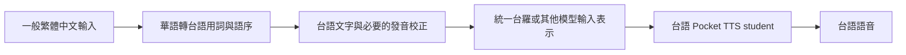
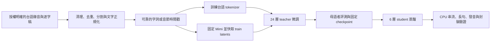

# 台語 Pocket TTS 訓練研究與實作計畫

執行更新：本文件保留訓練前的研究快照。使用者後續已核准 US$50 試跑預算，
句子級管線已開始實作與實跑；操作方式見[試跑指南](../taigi-pilot.md)，
驗證與進度見[執行計畫](../plans/2026-10-25-taigi-pipeline-execution.md)。

研究日期為 2026-10-25。本計畫針對台灣台語／Taiwanese Hokkien，語料代碼優先使用 `nan-tw`，不把台灣華語 `zh-TW` 當成台語。

使用者已確認產品目標是輸入中文、輸出台語語音。本計畫把「中文」解讀為一般繁體中文／華語句子。使用者不必輸入台羅，也不必先自行翻譯成台語。

**最新研究修正：下一個主要試驗採「完整繁體中文語意句子 → 完整台語錄音」的直接條件生成，不要求台羅／台語正字標註。** 詳見[直接中文到台語的研究結論](2026-10-25-direct-zh-to-taigi-pocket-tts-research.md)。下文保留原先台語文字中間表示與 aligned loader 的設計作對照；其中台羅及字詞對齊要求只適用該路線，不能當成所有台語模型的必要條件。

聲學模型仍考慮官方英文 24 層 teacher 微調、固定 Mimi，再蒸餾為 6 層 student。直接路線需先實作句子級 loader、中文 tokenizer 與相應評測，再做小規模學習驗證。只有幾小時語料時，成果應定位為可行性實驗，不能承諾通用台語模型。

本次完成研究與計畫，沒有建立 VM、啟動訓練或發布模型。預設優先考慮可公開發布且可商用的成果；這是規劃假設，不是對每份資料授權的認定。預算尚未指定。

後續的 Git 分支、個人 fork、資料版本、Nebius 儲存、W&B／TensorBoard 與續訓管理，另見[完整 ML pipeline 管理計畫](2026-10-25-taiwanese-pocket-tts-mlops-plan.md)。

使用者後續確認希望減少人為介入、沒有時間聽打。執行時以該管理計畫第 8 節為準：自動篩選、隔離不確定資料、使用既有標註作基準；本文件中的人工抽聽／新建人工評測要求不再是使用者必做工作。沒有人工驗證的品質項目明列未驗證。

## 讓使用者輸入中文、聽見自然台語

原先兩階段對照方案如下。它不再是唯一或主要試驗；最新直接路線由 Pocket 模型接收中文，生成台語音訊。若採此處的中間表示方案，台語文字與台羅都是內部表示，不是使用者必填欄位。



不能只將所有漢字逐字替換為台語讀音。翻譯前處理需處理詞彙、語序、否定、疑問、量詞、日期、金額及專有名詞，並保留原文的數字與語意。單字轉寫工具只負責其中的發音部分，不等於華語到台語翻譯。

| 產品實作方式 | 所需資料 | 優點與限制 | 選擇 |
| --- | --- | --- | --- |
| 華語轉台語前處理，再用台語 TTS | 台語逐字稿與台語音訊；另需驗證翻譯模組 | 可分別找出翻譯與發音錯誤，能使用現有台語逐字稿 | 可選對照方案 |
| 直接訓練華語文字到台語音訊 | 語意對應的完整華語句子與台語錄音 | 模型同時學語意轉換與語音；需句子級配對與 loader，無須台語逐字對齊 | 最新主要可行性試驗 |
| 漢字逐字改念台語 | 漢字到讀音字典 | 適用有限的讀字需求，不能保證自然台語表達 | 不作為本產品驗收標準 |

直接華語文字到台語音訊有文獻先例，但不能直接套用目前按同語言字詞切分的 loader。華語文本和台語音節不一定一一對應；新句子模式保留整句文字與完整音訊，搭配獨立提示或真正零提示，無須先取得原生台語對齊。Breeze 產生的華語轉寫可作自動篩選後的弱配對，保留其錯誤風險。

前處理模組先建立約 200 組「華語輸入、母語者核對的台語表達、發音」評測資料。以人工版本先驗證 TTS，再比較字典規則與候選開放權重翻譯／語言模型。這次尚未選定或實測翻譯模型，不能宣稱中文輸入端已解決。翻譯輸出保留原文與版本，拒絕無聲地改變金額、人名、時間、否定或數量。

發布時需要提供接受中文的應用程式或 wrapper。原生 `pocket-tts generate --text` 只把文字送進 TTS，不會自動做華語到台語翻譯。若模型使用台羅訓練，直接把一般華語傳給它也不能保證正確。單獨發布模型權重與發布完整中文輸入產品是兩個交付項目。

若希望整套產品保有 Pocket TTS 的 CPU、低延遲與離線特性，翻譯模組也要一起量測。較大的語言模型可能成為整體 RAM 與首段延遲的主要成本，不能只引用 TTS student 的效能。

## 已確認的程式基礎

本機版本為 `44cb63eaa4144f32ff80863968515165a5554353`，套件版本為 `4.0.1`。開始研究時工作目錄乾淨。以下以此版本實際程式為準，部分 AGENTS.md 的舊版說明已不適用。

| 現成元件 | 位置 | 台語專案的用途 |
| --- | --- | --- |
| 新語言 teacher 微調 | [finetune_language.yaml](../../training/configs/finetune_language.yaml) | 載入英文 24 層模型，重設文字 embedding |
| Student 蒸餾 | [depth_distill.yaml](../../training/configs/depth_distill.yaml) | 將 teacher 蒸餾成 6 層並吸收 CFG |
| 主訓練程式 | [train.py](../../training/train.py) | GPU 訓練、驗證、樣本、checkpoint、自動續訓 |
| 模型建構 | [builders.py](../../training/modules/builders.py) | 載入預訓練權重並固定 Mimi |
| 語料載入 | [loader.py](../../training/dataloader/loader.py) | 在字詞邊界切開提示音訊與目標音訊 |
| Tokenizer 訓練與轉換 | [train_tokenizer.py](../../training/scripts/train_tokenizer.py)、[convert_tokenizer.py](../../training/scripts/convert_tokenizer.py) | 建立台語詞表及 JSON tokenizer |
| 強制對齊 | [align_data.py](../../training/scripts/align_data.py) | 以相容的 Wav2Vec2 CTC 模型產生時間戳 |
| 模型輸出 | [checkpointing.py](../../training/checkpointing.py) | EMA FlowLM 與 Mimi 打包成 safetensors |

官方資料準備程式 `prepare_data.py` 專門處理 HiFiTTS-2，不能直接把台語資料 URL 傳入。`training/eval/librispeech.py` 是英文評測流程，也不能直接作為台語品質判定。[本機訓練文件](../../training/README.md)

目前 `pyproject.toml` 的 dev dependency group 已涵蓋訓練依賴，且沒有強制 CPU PyTorch index。GPU VM 應先 `uv sync`，再檢查 CUDA。不要根據舊文件重新加入 CPU index。[依賴設定](../../pyproject.toml)

## 選擇訓練路線

| 路線 | 優點 | 限制 | 本計畫選擇 |
| --- | --- | --- | --- |
| 24 層英文 teacher 微調，再蒸餾 | 有官方新語言範例，可保留聲學能力 | 仍需新的文字 embedding 與足夠台語資料 | 首選 |
| 直接微調 6 層模型 | 可省去一次蒸餾 | 不是官方建議的新語言主流程，品質需另測 | 後續低成本對照實驗 |
| 從頭訓練 teacher，再蒸餾 | 不依賴英文 backbone 初始化 | 小資料條件風險較高 | 暫不採用 |
| 只換台語 voice prompt | 很容易操作 | 聲音提示不會取代新語言文字與發音訓練 | 不作為台語適配方案 |

官方文件以約 100 小時作為新語言可開始實驗的尺度，以 1,000 小時以上作為較強模型的方向。這些不是硬性門檻，也不是台語品質保證。幾小時的資料可以驗證流程，但不能把反覆訓練的 epoch 當成新增語音覆蓋。[本機訓練文件](../../training/README.md)



## 篩選可用語料

「可下載」、「開放授權」、「允許 TTS 訓練」與「可公開發布衍生模型」是不同條件。每個資料來源需要保留版本、授權文件、原始 ID、語者與錄音來源。下表中的時數是來源公告值，不是本次清理後實測值。

| 資料 | 已確認的規模與格式 | 授權及取得情況 | 建議用途 |
| --- | --- | --- | --- |
| Mozilla Common Voice `nan-tw` | v27 公告共 24.08 小時、validated 21.87 小時、303 位語者；平均約 2.659 秒，短詞比例高 | CC0-1.0，下載另受 Data Collective 條款約束 | 優先盤點的多語者來源；21.87 小時仍不是清理後可訓練時數 |
| 台灣媠聲 SuíSiann 0.2.1 | 3,467 段、4:44:02、單一女聲，漢字與台羅對照 | 音訊 CC BY-SA 4.0；文本限定語音合成、需註明來源且不得改寫漢字 | 乾淨的小規模 TTS 流程驗證，單獨實驗並保留授權邊界 |
| TAT-TTS | 約 40.6 小時，4 位語者，48 kHz，漢羅、台羅、數字調與白話字 metadata | 公開申請合約限學術研究、禁止商業活動及轉交資料 | 僅列獨立學術研究選項；商業目標須另取得授權 |
| TAT Phase I | 600 位語者、300 小時，6 支麥克風同時錄製；16 kHz | 各子集取得條件不同，公開說明要求申請相關授權 | 多語者與腔調擴充候選；不能把 300 小時算成 1,800 小時獨立內容 |
| TAT-MOE 目前申請版 | 公告 208 小時、約 400 位語者，完整六麥克風 103 GB、單領夾麥克風 17 GB | 人工審核申請；不得轉交原始資料，成果需註明來源，改進需回饋 | 最值得申請的擴充候選；與 Phase I 有來源關係，不能加總，模型公開發布條件另確認 |
| ADI Taiwan-Tongues-ASR-CE Hokkien 彙整版 | 原始 train.tsv 共 31,482 筆，23,158 筆 `nan-tw`、2,792 筆 `zh-CN`、5,532 筆 locale 空白 | 實際 LICENSE 是 TRAIL 0.1，含資料、模型衍生與使用條件 | 保留為使用者指定來源，但先追溯、清理；與 Common Voice 去重，不當新增獨立語料 |

來源分別為 [Common Voice v27 官方資料卡](https://mozilladatacollective.com/datasets/cmu5vcwh800aknq07gjqn07ao)、[媠聲官網與版本紀錄](https://suisiann-dataset.ithuan.tw/)、[TAT-TTS 官方頁](https://sites.google.com/nycu.edu.tw/fsw/home/tat-tts-corpus)、[TAT 授權合約](https://www.aclclp.org.tw/doc/tat_e.pdf)、[TAT Phase I 官方頁](https://sites.google.com/nycu.edu.tw/fsw/home/tat-phase-i)、[TAT-MOE 官方申請頁](https://tggl.naer.edu.tw/corpora_applications/new)、[ADI train.tsv](https://huggingface.co/datasets/adi-gov-tw/Taiwan-Tongues-ASR-CE-dataset-hokkien/blob/main/train.tsv)。

媠聲介紹段落仍寫約 7 小時，但版本紀錄明列 0.2.1 為 4:44:02，7:00:54 是 0.1。應按版本統計，不能把不同版本加總。單語者資料只能做未見文本測試，不能聲稱已驗證未見語者泛化。

ADI 的原始 TSV 已確認混有華語，且多筆台羅的聲調字元已變成 `?`。不是只有網頁預覽的疑慮。先按原始 Common Voice clip ID 找回上游文本，再逐筆核對；無法修復的資料隔離，不把 ASR 猜測自動寫成真實標註。名稱含 Hokkien 不代表每一筆皆可用。[ADI 原始 TSV](https://huggingface.co/datasets/adi-gov-tw/Taiwan-Tongues-ASR-CE-dataset-hokkien/resolve/main/train.tsv)

三份 ADI 資料的 LICENSE 都是 TRAIL 0.1，而非資料卡上 `other` 所能完整表達。條款有 TRAIL-D 資料規則、TRAIL-M 衍生模型條件與用途限制。不能直接宣稱最後模型只有 MIT 或 Apache 條件；先確認資料訓練產物的適用方式。[ADI LICENSE](https://huggingface.co/datasets/adi-gov-tw/Taiwan-Tongues-ASR-CE-dataset-hokkien/blob/main/LICENSE)

Common Voice 的 CC0 與下載平台條款要分別保存。MDC 消費者條款禁止再識別說話者，限制資料重託管但保留適用資料授權明確允許的例外，並要求模型輸出揭露。不要把本計畫的模型發布步驟當成原始資料再發布授權。[MDC 消費者條款](https://mozilladatacollective.com/terms/consumers)

最先建立兩條實驗資料清單。第一條只納入已確認符合目標的寬鬆授權來源。第二條獨立納入媠聲等附條件資料，用於比較聲學品質。TAT 類申請資料不預先計入可用時數。若清理後只有個位數或數十小時，先做有限聲音與領域的實驗，並安排有明確訓練及發布同意的補充錄音。

### 納入使用者提供的英文與中文資料

使用者另外指定 [ADI 英文資料](https://huggingface.co/datasets/adi-gov-tw/Taiwan-Tongues-ASR-CE-dataset-en) 與 [ADI 台灣華語資料](https://huggingface.co/datasets/adi-gov-tw/Taiwan-Tongues-ASR-CE-dataset-zhtw)。資料預覽分別約 31.7k 與 119k 筆 train rows，部分來源是 Common Voice。筆數不能換算成獨立台語時數。

第一版先證明台語適配。英文可在後續作 replay 對照，測試能否減少原有英文能力流失；華語可在明確需要雙語或華台夾雜時加入。兩者不是增加台語監督資料的替代品，整段華語音訊不能配上台語翻譯當作 TTS pair。

若採多語訓練，另設獨立實驗，使用覆蓋各語言的 tokenizer、明確可學習的語言標記或輸入規範，以及按語言控制的取樣比例。台語與華語共享漢字卻讀音不同，需要防止模型混淆。同時測台語、華語、英文與夾雜語；不要只測平均分數。新語言流程會重設文字 embedding，不能假設加少量英文就能完整保留英文能力。

### 不計入即用 TTS 時數的其他候選

[TaigiSpeech](https://huggingface.co/datasets/TaigiSpeech/TaigiSpeech) 提供 3,079 段、21 位語者的語音意圖資料，但公開欄位沒有逐字稿，需先補標註。[iCorpus](https://iptt.sinica.edu.tw/shares/465) 是台華平行文字，不能提供聲學訓練對。[MinSpeech](https://minspeech.github.io/) 的閩南語影音與華語字幕也不能直接當台語逐字稿，且音訊來源權利與非商業註記不符合本計畫的即用資料條件。

## 定義台語文字與時間戳

第一版建議使用一套固定的台羅作為 TTS 內部模型輸入，保留聲調；產品入口維持一般中文。這是降低混合拼寫與對齊複雜度的工程選擇，尚未證明優於原生台語漢字輸入。保留華語原文、台語漢字、原始羅馬字及標準化結果，後續才能做對照。

文字處理需要明確定義 Unicode NFC、聲調符號或數字調、連字號、輕聲、鼻化、大小寫、數字讀法、標點及華台夾雜的處理方式。訓練與推論必須使用相同規則。不要混用部分本調、部分變調標註，也不要對音檔做固定比例時間切分來假造字詞時間戳。

研發時可直接輸入台羅來隔離聲學模型問題；正式產品需先將華語翻譯成台語，再執行必要的台語漢字到台羅轉寫。多音字、文白異讀與口音選擇不能靠任意 transliteration 當成正確答案。[Taibun](https://github.com/andreihar/taibun) 有台語轉寫及斷詞功能，可作候選發音工具；需以資料原有台羅與母語者標註驗證。它不能單獨代替華語到台語翻譯。

現有 loader 接受以下形狀。這只是欄位示意，時間戳不是實際對齊結果。

```json
{"path":"/data/taiwanese/clip.wav","start":0.0,"duration":4.0,"transcript":"lí-hó Tâi-uân","words":[{"word":"lí-hó","start":0.2,"end":1.4},{"word":"Tâi-uân","start":1.8,"end":3.7}]}
```

時間戳相對於該 utterance，`start` 是原始檔案的位移。模型不是靠 `speaker_id` embedding 學語者，loader 會從同一句前段取聲音提示，後段才是文字對應的生成目標。語者 ID 仍應保存在額外的來源索引中，用於分割資料與評測。[資料型別](../../training/dataloader/types.py)、[切分實作](../../training/dataloader/loader.py)

現有 loader 要求切點前後各至少 1 秒，而且必須有內部對齊邊界。因此總長超過 2 秒不等於合格。先統計有效切點通過率與剩餘時數；短單詞或無法切分的錄音先排除。若因此丟失大量資料，另立小實驗改用同語者另一段提示音訊，需修改 loader 及驗證，不能任意串接不同語者，也不能沿用重疊 fallback。

實際 target text 來自 `" ".join(w["word"] for w in entry.words[i:])`，不是直接使用原始 `transcript`。對齊器需要的字元表示與模型的台羅文字應分開保存，保留位置映射。每個切點都要驗證重建出的後段文字與正確台羅一致。若把連字號拆成空白、去除聲調或標點，不能直接把那份對齊文字交給模型。音節時間戳只有在維持這項文字契約時才適用。

必須攔截三種情況。

1. 沒有 `words` 會失敗。只有一個涵蓋全句的 `word` 則可能進入提示與目標重疊的 fallback。資料檢查必須要求存在有效的非重疊切點。
2. 原始錄音太長時，loader 會截短音訊但保留後續全部文字。匯入器要先在可靠邊界切成不超過設定上限的 utterance，不能只設定 `max_duration_sec`。
3. 英文 aligner 的字彙不適合台語。現有腳本會移除 CTC 字彙中不存在的字元，因此要先檢查台羅聲調及特殊字元覆蓋率，再檢查音訊邊界。

[emlinking 的台語 Wav2Vec2 CTC](https://huggingface.co/emlinking/wav2vec2-large-xls-r-300m-tsm-asr-v6) 是可調查的台羅對齊候選，但該模型只報告 9.57 小時訓練資料及 66.6% WER，卡片也沒有明確授權標籤。不能直接把它當作成熟對齊器或品質裁判。其文字規範與授權需先確認；若不合適，另訓練有授權的 CTC aligner，或使用人工校正的可靠時間戳。

不要把 Whisper 模型名稱直接傳給 `align_data.py --model`。腳本明確載入 `Wav2Vec2ForCTC`。若使用其他 ASR 的時間戳，必須另外轉換、核對逐字稿並驗證邊界。

## 使用 Breeze-ASR-26 輔助資料檢查與評測

採用使用者提供的 [MediaTek-Research/Breeze-ASR-26](https://huggingface.co/MediaTek-Research/Breeze-ASR-26) 作第一個 ASR 候選。模型卡標示 Apache 2.0，架構是 Whisper，並明列可用於台語 TTS 的相對 CER 評測。ASR 在這裡是輔助工具；若已有可靠逐字稿與時間戳，TTS 訓練本身不需要額外串接 ASR。

關鍵限制是該模型卡明說輸出偏華語漢字轉寫，而不是台語正字或台羅。因此它適合找漏句、異常內容與比較同一套文本下的 TTS 結果，不能直接取代台羅標註，也不能把華語化輸出當作音節一一對應的台語逐字稿。計算 CER 必須用同一套人工定義的表示法，與母語者原生台語轉寫指標分開報告。

已讀取 [config.json](https://huggingface.co/MediaTek-Research/Breeze-ASR-26/blob/main/config.json)，確認 `WhisperForConditionalGeneration`。其 [generation_config.json](https://huggingface.co/MediaTek-Research/Breeze-ASR-26/blob/main/generation_config.json) 有 `alignment_heads` 和 timestamp token 設定，表示可研究 Whisper 的時間戳路徑；本次未執行模型，不能據此聲稱台語字詞邊界已準確。這些設定也不會讓它變成 CTC aligner。

P1 新增三個實驗產物。

1. 以人工核對的真實台語樣本跑 Breeze，保留原生台語逐字稿與 Breeze 輸出，標記華語化差異。
2. 在少量樣本上測 segment 與 word timestamp 路徑，人工檢查是否對應實際讀音。只有通過的 adapter 才能寫入 Pocket TTS 的 `words`。
3. 若 Breeze 的轉寫不能和原生文本一一映射，保留它作內容篩選與相對評測，繼續採用相容的台語 CTC／人工校正對齊。不要為方便接入而改壞訓練文本。

ASR 推論可與 TTS 訓練分開排程，釋放 GPU 記憶體後再載入 teacher。第一輪雲端費用需把 Breeze 推論與對齊算入準備階段。

## 按可驗證階段推進

以下門檻是本專案建議的驗收條件，尚無台語實測結果。每階段留下資料清單、設定版本、日誌與音訊後，才進下一階段。

| 階段 | 工作與產物 | 通過條件 |
| --- | --- | --- |
| P0 資料盤點 | 來源、授權、語種、語者、時數、重複率、有效切點通過率與下載流程 | 能重建清單與實際可訓練時數；未知授權與未知來源資料不進正式 train |
| P1 小樣本與 codec 驗證 | 約 200 段人工核對資料、文字規則、對齊與 Mimi encode/decode 音檔；另建立華語輸入到台語表達評測集 | 兩位母語者檢查代表性聲調、鼻化、塞音韻尾；codec 重建沒有系統性破壞關鍵音素 |
| P2 GPU smoke run | 小批次訓練、樣本生成、存檔與續訓 | loss 有限、非零梯度、權重有變、正確 step 續訓、可輸出音訊；不以此宣告品質達標 |
| P3 Teacher pilot | 先在小而乾淨資料上跑 5k、15k、25k 檢查點 | 未見文本可懂度有改善，無持續過擬合或嚴重漏讀；不進步就回查資料與對齊 |
| P4 Teacher 擴充 | 擴增合格資料、固定評測集、比較設定 | 以人工評測及校準後 ASR 選 checkpoint，不依訓練 loss 或最後 step 單獨選擇 |
| P5 Student 蒸餾 | 用固定 teacher EMA 訓練 6 層 student | 相同文本、聲音提示與採樣設定下，比較 teacher/student 的可懂度、漏讀與自然度 |
| P6 中文輸入產品與發布候選 | 華語到台語前處理、中文入口 wrapper、safetensors、tokenizer、YAML、model card 與評測報告 | 中文輸入保留語意並輸出自然台語；乾淨環境可載入，端到端延遲與記憶體達標；發布來源完成核對 |

P1 的 200 段要涵蓋不同長度、聲調組合、口音與錄音條件。抽查全部提示／目標切點，任何落在發音中的系統性錯誤都先修正。正式語料需檢查單聲道、採樣率、削波、背景音樂、多語者重疊、空音、逐字稿不符、尾端靜音及短詞比例。

資料分割按語者與錄音來源分組，避免同一錄音的不同麥克風、不同切片或重複版本跨 train/test。另排除相同句子造成的文字洩漏，保留約 200 句母語者核對的固定測試文本。先保留官方 test split，再盤點可安全用於 train 的資料，不能把 `validated` 與它的 train/dev/test 子集全部相加。

Mimi 重建是前置實驗。若聲調資訊在 codec 重建已明顯受損，增加 FlowLM 訓練時間不能解決該問題；屆時才研究 codec 適配。預設保持 Mimi 不動，避免把專案擴大為另一個 codec 訓練研究。

## 準備 Nebius VM 與預算

首選 `eu-north1` 的 `gpu-h100-sxm`、`1gpu-16vcpu-200gb`，一張 80 GB H100。建議先配置 100 GiB 系統碟及 300–500 GiB 工作碟，再按解壓後音訊、cache 與 checkpoint 實測調整。使用官方附 NVIDIA driver 的 Ubuntu image。帳號 quota 與實際容量尚未查詢，部署時需核對。[Nebius GPU 規格](https://docs.nebius.com/compute/virtual-machines/types)、[建立 VM 指引](https://docs.nebius.com/compute/quickstart)

| GPU | 2026-10-25 隨選公開價格 | 本專案判斷 |
| --- | --- | --- |
| H100 80 GB | US$4.50／GPU 小時 | 首選，最容易對照官方訓練基準 |
| H200 141 GB | US$5.40／GPU 小時 | H100 無容量或確有額外記憶體需求時使用 |
| RTX PRO 6000 96 GB | US$1.80／GPU 小時 | 後續成本比較候選；先測相同工作量的吞吐，不能假設與 H100 同速 |

價格不含稅及儲存。Spot 是動態價格，不以頁面「from $0.79」估固定全程成本。[Nebius 官方價目](https://nebius.com/prices)

下列是將本機 README 的英文基準乘上 H100 公開價格所得，並非本次台語實測。假設 teacher 6.3 steps/s、student 10.5 steps/s、有效 batch 64。

| 訓練部分 | 算式 | 理想化純訓練時數 | 計算費 |
| --- | --- | --- | --- |
| Teacher pilot 25k steps | 25,000 ÷ 6.3 ÷ 3,600 | 1.10 小時 | 約 US$4.96 |
| Teacher 250k steps | 250,000 ÷ 6.3 ÷ 3,600 | 11.02 小時 | 約 US$49.60 |
| Student 200k steps | 200,000 ÷ 10.5 ÷ 3,600 | 5.29 小時 | 約 US$23.81 |

一輪 teacher 加 student 的理想化計算值約 US$73.41，但不含下載、對齊、latent 預計算、編譯、驗證生成、重跑與等待人工試聽。建議第一輪規劃 US$100–300 的雲端實驗額度，pilot 先設 8 GPU 小時的停止點，檢查結果再續。這是提議額度，尚未獲得支出指示。語料取得、補錄與人工校對另計，通常比單輪 GPU 成本更值得先釐清。

第一個有效 run 先量測穩定 500 steps 的吞吐、峰值 VRAM、資料等待與有效音訊秒數。分開記錄初始化和 latent precompute，重新預估剩餘費用。不要按 H100 的數字推估 RTX PRO 6000。多卡只在單卡測試證明需要縮短等待時採用；官方 1→8 H100 teacher 基準只有 6.3→10.4 steps/s。[本機基準來源](../../training/README.md)

執行管理需要保存最新 `checkpoint_*.pt` 與相同 step 的 `optim_*.pt`，連同 tokenizer、設定、git SHA、依賴版本及資料雜湊備份。每次實驗使用不同 `run_dir`，避免自動接續錯誤實驗。Spot 切換前先證明中斷與恢復正常。[checkpoint 實作](../../training/checkpointing.py)

訓練 latent cache 只供 train 使用。`valid_jsonl` 保留指向原始音訊的 aligned manifest，現有訓練程式明確拒絕驗證使用 latent-backed `.meta.json` manifest。[train.py](../../training/train.py)

停止 VM 要使用 Nebius console 或 CLI。單純在 Linux 執行 `shutdown` 會被服務視為故障並重啟，繼續計費。停止運算後儲存仍計費。[Nebius 關機行為](https://docs.nebius.com/compute/virtual-machines/stopped-with-linux-commands)、[計費說明](https://docs.nebius.com/compute/resources/pricing)

## 使用現成訓練程式

以下是後續實作的命令模板。`taiwanese_*.yaml`、台語 manifests 與 evaluator 尚未建立，不能把這段當成今天已可直接執行的完整 recipe。

```bash
uv sync
uv run python -c 'import torch; print(torch.__version__, torch.version.cuda); assert torch.cuda.is_available(); print(torch.cuda.get_device_name())'

uv run python -m training.scripts.train_tokenizer \
  data/taiwanese/tokenizer data/taiwanese/train_aligned.jsonl \
  --vocab-size 4000 --character-coverage 1.0

uv run python -m training.scripts.convert_tokenizer \
  data/taiwanese/tokenizer.model \
  --out data/taiwanese/tokenizer.json \
  --texts data/taiwanese/valid_aligned.jsonl

uv run python -m training.train training/configs/taiwanese_teacher.yaml
uv run python -m training.train training/configs/taiwanese_student.yaml
```

若 4,000 詞表與完整字元覆蓋在實際文本上不能成立，先調整並驗證詞表，讓所有 config 的 `n_bins` 等於實際詞表大小。不要為了消除錯誤默默刪除台語文字。Tokenizer 只從 train 擬合，validation 用於轉換一致性與未知字元檢查。

Teacher 設定從 `finetune_language.yaml` 複製，保留未列出的必要欄位，修改以下部分。

```yaml
model_config: pocket_tts/config/english_2026-04_24l.yaml
model_overrides:
  flow_lm.lookup_table.tokenizer: tokenizers
  flow_lm.lookup_table.tokenizer_path: data/taiwanese/tokenizer.json
  flow_lm.lookup_table.n_bins: 4000
start_from_pretrained: true
reset_text_embedding: true
data:
  train_jsonl: data/taiwanese/train_aligned.jsonl
  valid_jsonl: data/taiwanese/valid_aligned.jsonl
  max_duration_sec: 30.0
  max_voice_prompt_sec: 5.0
run_dir: runs/taiwanese_teacher
batch_size: 64
grad_accum_steps: 1
max_steps: 25000
```

保留官方初始基準 `optim.lr: 2e-4`、constant schedule、`flow_batch_multiplier: 4`。把 `sample_sentences` 換成母語者核對的台語文本。先跑 pilot，評估後才延長至 100k–250k 或調整策略。250k 是實驗上限候選，不是台語必須跑到的數字。

現有新語言範例把 `.model` 路徑搭配 `tokenizers` backend，會交給 JSON reader。上面的 JSON 轉換可避免此問題。另一條有效方法是明確設定 `flow_lm.lookup_table.tokenizer: sentencepiece`，並使用 `.model`。本次直接執行該 dispatch 函式確認兩者差異。[Tokenizer dispatch](../../pocket_tts/modules/text_conditioner.py)

Student 設定從 `depth_distill.yaml` 複製。兩側使用 teacher 的同一份底層模型設定，僅改 student 深度，避免無意間混入不同日期的 Mimi 權重。以下 `<selected-step>` 需替換成通過評測的 checkpoint 編號。

```yaml
model_config: pocket_tts/config/english_2026-04_24l.yaml
model_overrides:
  flow_lm.transformer.num_layers: 6
  flow_lm.lookup_table.tokenizer: tokenizers
  flow_lm.lookup_table.tokenizer_path: data/taiwanese/tokenizer.json
  flow_lm.lookup_table.n_bins: 4000
start_from_pretrained: false
reset_text_embedding: false
distill_teacher_config: pocket_tts/config/english_2026-04_24l.yaml
distill_teacher_overrides:
  flow_lm.lookup_table.tokenizer: tokenizers
  flow_lm.lookup_table.tokenizer_path: data/taiwanese/tokenizer.json
  flow_lm.lookup_table.n_bins: 4000
distill_teacher_weights: runs/taiwanese_teacher/checkpoint_<selected-step>.pt
distill_teacher_use_ema: true
distill_cfg_coef: 2.0
text_dropout: 0.0
voice_dropout: 0.0
run_dir: runs/taiwanese_student
num_ckpt_keep: 3
```

Student 同樣替換 train/valid manifests 與樣本文本，先保留官方 `lr: 4e-4`、cosine schedule 與 200k 上限作基準。驗證頻率與保留 checkpoint 數量要符合小資料的實驗需求。Teacher 和 student 都必須載入相同的台語 tokenizer，不能只改 teacher。

有效 batch 為 `batch_size × grad_accum_steps × GPU 數量`。一張 GPU 可改成 16×4 以減少記憶體，但須重新量測速度。Tiny smoke run 使用更小 batch，`data.loader_procs: 1`、`data.num_bucket_batches: 1`，必要時 `compile: false`，避免少量資料無法填滿 loader bucket。

Hugging Face 主模型目前需要接受存取條件。先確認指定 teacher revision 可讀取再租 GPU。訓練 builder 直接讀 `weights_path`，不能假設它會自動採用 inference 的 without-voice-cloning fallback。程式的 MIT 授權與模型卡的 CC BY 4.0 是不同資產的條件。[程式 LICENSE](../../LICENSE)、[模型卡](https://huggingface.co/kyutai/pocket-tts)

## 評測台語，而非只看 loss

先由至少兩位台語使用者核對測試文本與讀法。第一版建議保留 200 句固定文本，區分未見文本、未見語者、口音、短句、長句、數字、人名地名、文白異讀與夾雜語。

| 指標 | 方法與判讀 |
| --- | --- |
| 中文輸入的語意保留 | 母語者核對台語輸出是否忠於華語原文，分開記錄翻譯錯誤與 TTS 漏讀 |
| 可懂度 | 母語者盲聽轉寫；使用固定文字規範計算字元或音節錯誤率 |
| 發音 | 分開記錄本調、變調、鼻化、送氣、塞音韻尾與文白異讀錯誤 |
| 自然度 | 隨機順序的 teacher/student 配對試聽，另看韻律與停頓 |
| 完整性 | 記錄漏讀、重複、首尾截斷、沉默與未觸發 EOS 的比例 |
| 語者 | 同意使用的提示音訊，配合人工判斷與 speaker similarity，避免只報 embedding 分數 |
| CPU 部署 | 固定硬體與 thread 數，量測首段延遲、完整生成時間、峰值 RAM |

ASR 只能作輔助。先量測 ASR 在人工逐字稿的真實台語錄音上有多少錯誤，再用它比較 TTS。不要用英文 WER normalizer 處理台羅，也不要把「ASR 能猜對」當成聲調正確。Breeze Taigi 研究提供台語評測方向，但其論文也顯示 ASR 仍有可觀錯誤；不能視為無誤的裁判。[Breeze Taigi 論文](https://arxiv.org/abs/2603.19259)

Teacher 的 CFG=2 評測需使用訓練模型的生成路徑或改寫 evaluator。公開 `pocket-tts generate` 沒有 `--cfg` 選項。Student 蒸餾後則測正式 CLI 與 Python API。[CLI](../../pocket_tts/main.py)、[訓練模型](../../training/modules/model.py)

發布門檻可先提議為母語者盲聽詞／音節正確率至少 90%，固定測試集嚴重漏讀、重複或 EOS 失敗不超過 2%，且 student 相對 teacher 正確率下降不超過 2 個百分點。這些是待 pilot 校準的專案目標，不是已達成結果或通用研究標準。CPU 使用 `RTF = 生成秒數 ÷ 音訊秒數`，指定部署機器上目標小於 1；不要與 README 使用的「倍速」定義混淆。

## 整理發布產物與後續檔案

發布候選需包含中文輸入的翻譯與發音前處理、wrapper、`model.safetensors`、`tokenizer.json`、完整 inference YAML、文字正規化規則、訓練設定、資料來源與授權紀錄、model card、評測結果及有權發布的示範聲音。輸出的 safetensors 包含 FlowLM 和 Mimi，但不會自動替你產生完整 YAML 或封裝 tokenizer。[輸出實作](../../training/checkpointing.py)

每次 checkpoint 儲存都會覆寫 run 目錄的 `model.safetensors`，舊 `.pt` 也可能被保留數量限制刪掉。評測選中的 teacher 與 student checkpoint 要立即複製到獨立的候選目錄，再以該 step 的 EMA 明確重新輸出。發布前記錄對應 SHA 與 step，不能把最新 export 當成最佳 checkpoint。

Inference YAML 要明確指定 6 層 student、台語 tokenizer 路徑與新權重。對大小寫、末尾標點、`。！？` 切句以及短句 padding 做測試，避免推論時改變訓練所見文字。現有程式提供部分 config 開關，但目前沒有完整台語前處理。[文字切句實作](../../pocket_tts/models/text_chunking.py)

建議後續依序實作以下檔案，名稱是提案，尚未建立。

1. `training/scripts/prepare_taiwanese.py` 與來源索引。產生可重建、去重且有來源的 manifests。
2. 台語 normalization 與 manifest validator。驗證文字、時間戳、有效切點及長度，必要時擴充 alignment adapter。
3. `training/configs/taiwanese_teacher.yaml`、`taiwanese_student.yaml`。固定模型、tokenizer 與 Mimi 來源。
4. `training/eval/taiwanese.py` 與固定評測清單。輸出音訊、可懂度及失敗統計。
5. 華語到台語的前處理與中文輸入 wrapper。保留可追溯的中間文本，先單獨驗證翻譯品質，再接 TTS。
6. `pocket_tts/config/taiwanese.yaml` 與發布文件。證明乾淨安裝可載入，並分別測 CPU TTS 與完整中文到台語流程。

若資料與權重存取已具備，建議先安排 2–4 個工作天完成 P0–P2，再安排約一週完成聲學模型 pilot、人工試聽與第一輪 student。這是工程排程估計；授權申請、缺少 aligner、補錄資料與中文到台語翻譯模組可能成為主要工期。翻譯模組尚未選型，完整產品工期與計算成本須在 P1 後重估，不能用 GPU 小時推算整體完成日期。

## 研究方法與尚未證明的事項

本次使用 [pstack 的 Investigation playbook](https://github.com/backnotprop/pstack/blob/18b6c36e6e201b110acc62472de987416ac4e23b/skills/poteto-mode/playbooks/investigation.md) 與 `how` 研究流程，版本為 `18b6c36e6e201b110acc62472de987416ac4e23b`。以 Astra 核查訓練程式，Sol 核查語料，主代理整合原始來源與 Nebius 官方資料。這是有階段建議的研究交付，不是啟動自動 PR／訓練計畫。

`throughput checkpoint: n/a, read-only investigation`

pstack 的 Guard the Context Window 原則讓程式與資料研究分開進行。Sequence Work into Verifiable Units 原則讓計畫先驗證資料與 codec，再投入完整訓練。Prove It Works 原則要求直接檢查程式與輸出。本次實際執行了現有 `build_tokenizer` 和 `_choose_cut` 的隔離函式檢查，確認 tokenizer 格式選擇，以及單一時間戳跨度沒有有效切點；這不是實際音訊對齊或 GPU 訓練測試。

ADI 原始 TSV 的固定 revision、雜湊、語種統計與損壞字元證據另存於 [資料檢查紀錄](2026-10-25-adi-hokkien-evidence.json)。主代理重新下載固定 revision 的 train.tsv，獨立核對 SHA-256 與三類 locale 計數。

尚未證明的事項包括中文到台語的翻譯品質、清理後可用台語時數、各來源模型發布權利、候選 CTC 對齊品質、Mimi 對台語關鍵發音的重建品質、Nebius 帳號容量、台語訓練吞吐、台語可懂度，以及完整產品的 CPU 延遲。P0–P6 分別產生這些證據。下一個具體工作是 P0 與 P1 的資料清單、中文／台語對照評測集及小樣本驗證。
